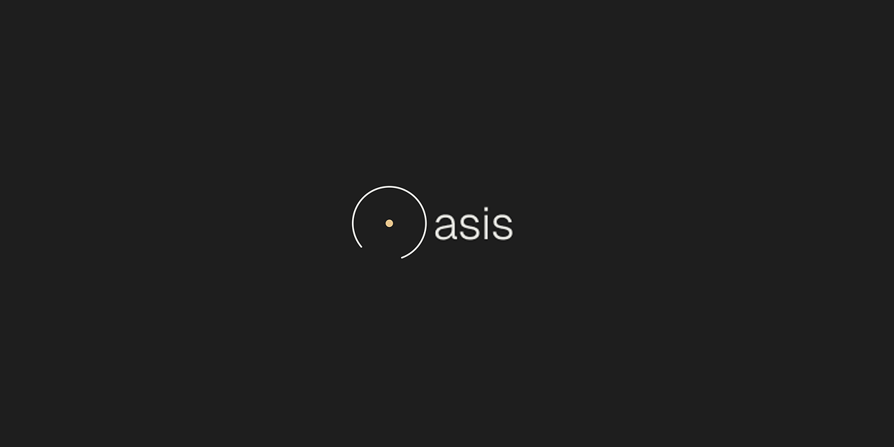

# oasis


2026-11-19: [changelog](changelog.md)
resource curation bot for Discord: members submit files / link -> mod-only review channel -> moderators approve / reject: if approved -> published to a text / forum; -> member gets notified whether approved / rejected.

built with node, discord.js and mongodb.

## features
- `/submit link` and `/submit file`: up to 5 links (`url`, `url2` ... `url5`) or up to 5 files per submission. the title goes in the command, then a button opens a modal for the description (up to 1000 characters, markdown and line breaks work) and, when the public channel is a forum, a tag picker (1 to 5 tags). an unfinished draft expires after 2 days
- links are cleaned up before they are saved, so none are refused over small things: the scheme is optional, `<https://...>` and pasted `[text](url)` work, `ftp://` is allowed, spaces become `%20`, and a host without a dot (`http://localhost:3000`) is fine when the scheme is typed. only `javascript:`, `data:`, `file:` and bare words are refused. any file type is accepted
- review: each submission lands in the review channel with **Approve & Publish** and **Reject** buttons (needs **Manage Messages**). reject asks for a reason (up to 500 characters) that is sent to the member. a submission can only be handled once, so two moderators clicking together can't publish it twice
- the review message pings a reviewer role, set with `/configure reviewer-role`. the ping is the only mention Oasis lets through; text from members never pings anyone
- possible duplicates are flagged, never rejected: a link that matches another resource (same page, ignoring `www`, a trailing slash, `utm_` tags and `#fragments`) or a file with the same name and size shows a **Possible Duplicate** line on the review message, and the member gets a DM saying the moderators will decide
- published post: one container with the title and `ID:n`, contributor, publish date, description, tags, and the link or links (several links show as a quoted list) or the files. images go in a gallery and other files are attached as cards. files over 10 MB can't be re-attached, so they are linked instead. a **Bookmark** button sits under the post. if Discord refuses the container, the post is published as a classic embed
- DMs to the member (approved with a **Go to Post** button, rejected with the reason, possible duplicate) carry the Oasis banner and the server icon. when a DM can't be sent as a container it falls back to plain text
- `/search query [tags]`: finds published resources. every word of the query is looked for in the title, description, tags, links and file names, and results are ordered by how many of the words match: all words first, then the first word only, then the second, and so on. `*` lists everything. `tags` (comma separated, autocompletes from the tags in use) keeps only resources that have all of those tags. results are paged and shown with the server icon and the Oasis banner
- `/mysubmissions`: your own submissions in this server with their status (pending, approved, rejected, unpublished) and the rejection reason. only you see it
- `/bookmark add|remove|list`: save resources to your account, up to 100 per server. `add` and `remove` take a resource id (`12` or `#12`) or a title, with autocomplete. the **Bookmark** button on a post toggles the same bookmark. only you see your list
- `/leaderboard`: top 10 contributors by published resources, with your own rank in the footer
- `/resource edit|unpublish` (needs **Manage Messages**): `edit` changes the title, description or tags (tags on forums only) of a published resource and rewrites the post, keeping its publish date and marking it `Edited`. `unpublish` asks first, then deletes the post and drops the resource from search, bookmarks and the leaderboard. the member is not notified
- `/configure review-channel|public-channel|reviewer-role|view|reindex` (needs **Manage Server**)
- `/ping` shows the websocket heartbeat and how long a reply takes. `/help` lists every command

## resource ids
every published resource gets a number per server, shown after its name as `ID:12` and used by `/bookmark` and `/resource`. it is given on approval, in order, and never reused. `/configure reindex` gives numbers to resources that were published before ids existed, oldest first.

## old posts
posts published before `/search` existed are not in the database, so they are missing from search, bookmarks and the leaderboard. run `/configure reindex` once per server: it reads the public channel (up to the latest 1000 posts, forum threads or messages the bot sent), saves each old embed post with its title, description, link or files, contributor and tags, and numbers them. running it again skips what is already saved.

an old embed post can be rewritten as a container with `/resource edit` (pass any option, for example the same title). the file attachments already on the post are reused. if Discord refuses the conversion, only the embed's title and description change.

## storage
mongodb, database `oasis`:
- `configs`: the channels and reviewer role per server
- `drafts`: unfinished submissions, removed automatically after 2 days
- `submissions`: every submission with its status, and for published ones the post location, files and number
- `counters`: the next resource number per server
- `bookmarks`: one document per member, server and resource

## prerequisites
* **node.js** (v18.x or higher recommended)
* a discord bot token and client id. no privileged intents are needed
* a mongodb atlas database connection string

## self-host
1. clone the repo
2. configure `.env`:
   ```env
   DISCORD_TOKEN=your_bot_token_here
   CLIENT_ID=your_client_id_here
   MONGODB_URI=...
   # optional
   PORT=3000                # keep-alive web server, for hosts that need an open port
   ```
3. install dependencies and start the bot (slash commands register themselves on start, globally):
   ```bash
   npm i
   node index.js
   ```

## server setup
1. invite the bot with the `bot` and `applications.commands` scopes. it needs to see the review and public channels and send messages there, create posts and attach files on a forum, and mention the reviewer role (the role must be mentionable, or the bot needs **Mention Everyone**)
2. run the setup commands:
   `/configure review-channel channel:#moderator-review`
   `/configure public-channel channel:#resources`
   `/configure reviewer-role role:@reviewers` (optional)
   `/configure view`
3. members try `/submit`, and `/help` lists everything

## license
mit
